<picture><source media="(prefers-color-scheme: dark)" srcset="assets/hero-dark.svg"><source media="(prefers-color-scheme: light)" srcset="assets/hero-light.svg"></picture>

<a href="https://runio.dev"><picture><source media="(prefers-color-scheme: dark)" srcset="assets/nav-website-dark.svg"><source media="(prefers-color-scheme: light)" srcset="assets/nav-website-light.svg"></picture></a>
<a href="https://runio.dev/blog"><picture><source media="(prefers-color-scheme: dark)" srcset="assets/nav-blog-en-dark.svg"><source media="(prefers-color-scheme: light)" srcset="assets/nav-blog-en-light.svg"></picture></a>
<a href="https://runio.dev/de/blog"><picture><source media="(prefers-color-scheme: dark)" srcset="assets/nav-blog-de-dark.svg"><source media="(prefers-color-scheme: light)" srcset="assets/nav-blog-de-light.svg"></picture></a>
<a href="https://runio.dev/ar/blog"><picture><source media="(prefers-color-scheme: dark)" srcset="assets/nav-blog-ar-dark.svg"><source media="(prefers-color-scheme: light)" srcset="assets/nav-blog-ar-light.svg"></picture></a>
<a href="https://www.youtube.com/@amer"><picture><source media="(prefers-color-scheme: dark)" srcset="assets/nav-youtube-dark.svg"><source media="(prefers-color-scheme: light)" srcset="assets/nav-youtube-light.svg"></picture></a>
<a href="https://www.linkedin.com/in/amermmohammed/"><picture><source media="(prefers-color-scheme: dark)" srcset="assets/nav-linkedin-dark.svg"><source media="(prefers-color-scheme: light)" srcset="assets/nav-linkedin-light.svg"></picture></a>
<a href="https://x.com/ameralrawi"><picture><source media="(prefers-color-scheme: dark)" srcset="assets/nav-x-dark.svg"><source media="(prefers-color-scheme: light)" srcset="assets/nav-x-light.svg"></picture></a>

I work from Düsseldorf on online shops for <a href="https://github.com/winkelwagen-de">Winkelwagen</a> in Berlin. Sometimes I record what I learn. No upload schedule, no promises.

<h3 align="center">A few videos</h3>

<!-- videos:start style=cards -->
<table>
<tr>
<td width="33%" valign="top"> <a href="https://www.youtube.com/watch?v=ejH1dROc-rA">An external API in a Shopware app: a nightly sync with Symfony</a></td>
<td width="33%" valign="top"> <a href="https://www.youtube.com/watch?v=CGFFUEQOvw8">A page in the Shopware admin: app modules and the Meteor Admin SDK</a></td>
<td width="33%" valign="top"> <a href="https://www.youtube.com/watch?v=2D_NS9BxWqM">A Shopware app server with Symfony: how the shop registers</a></td>
</tr>
</table>
<!-- videos:end -->

<h3 align="center">Can you leave work on time?</h3>

<b>Friday, 16:40. Four bugs before you can go home. Click to start.</b>

<b>16:41.</b> A shop's scheduled task has not run since Tuesday. What do you try?

Clear the cache

Still broken. The cache is innocent this time.

<i>Close this and try another.</i>

Start the workers

Fixed. Scheduled tasks need something running to pick them up.

<b>16:47.</b> You changed an app's <code>manifest.xml</code>, but <code>app:refresh</code> ignores it.

Run it again, harder

Still ignored. Confidence is not a flag.

<i>Close this and try another.</i>

Delete the app folder

Now you have two problems.

<i>Close this and try another.</i>

Bump the version

Fixed. The refresh sees a new version and reads the manifest.

<b>16:52.</b> Shopware runs in Docker and cannot reach your app server on <code>localhost</code>.

Use <code>host.docker.internal</code>

Fixed. Inside the container, localhost is the container.

<b>16:58.</b> The app's admin page shows an error after exactly five seconds.

Make the page load faster

Still errors. The admin is waiting for a message.

<i>Close this and try another.</i>

Hide the error with CSS

Tempting. It is still there, and now you know it.

<i>Close this and try another.</i>

Send <code>sw-app-loaded</code>

Fixed. The admin now knows your page is ready.

<b>17:00. All fixed.</b> Nobody noticed anything, which is how you know it went well. Go home.

Open every port

Still broken, and security would like a word.

<i>Close this and try another.</i>

Restart Docker

It came back up with exactly the same opinion.

<i>Close this and try another.</i>

Raise the PHP memory limit

Still broken, but now it is broken with more memory.

<i>Close this and try another.</i>

 

<picture><source media="(prefers-color-scheme: dark)" srcset="assets/certificate-dark.svg"><source media="(prefers-color-scheme: light)" srcset="assets/certificate-light.svg"></picture>

Still suspicious? Run <code>git blame</code>
<pre>e5f1a02 (Amer   03:12) every pixel of this profile
9c0d7be (Amer   03:13) was placed by hand
41fe88a (Amer   03:14) using nothing but willpower
d3adb33 (Claude 03:14) You're absolutely right!
7aa01c4 (Amer   03:15) ignore that line</pre>

